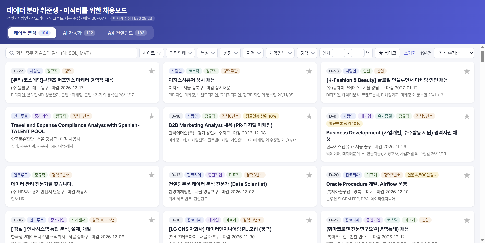
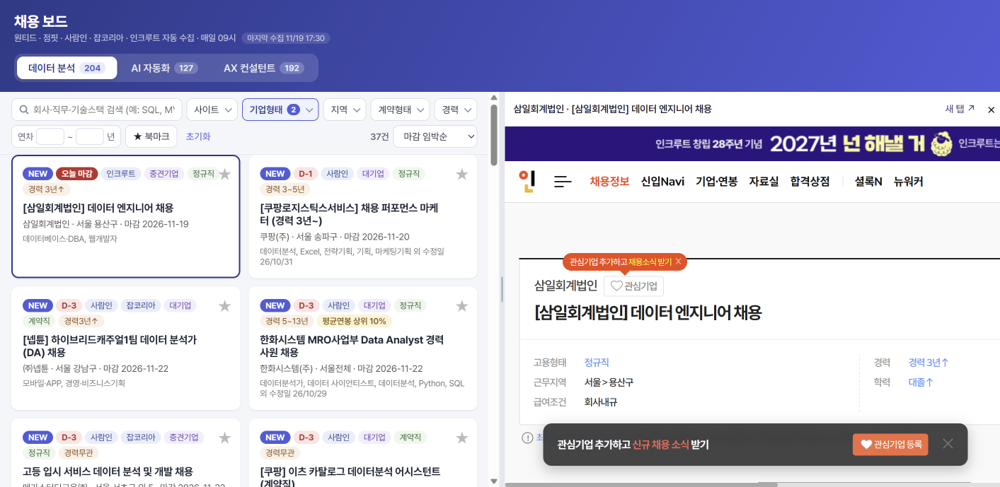
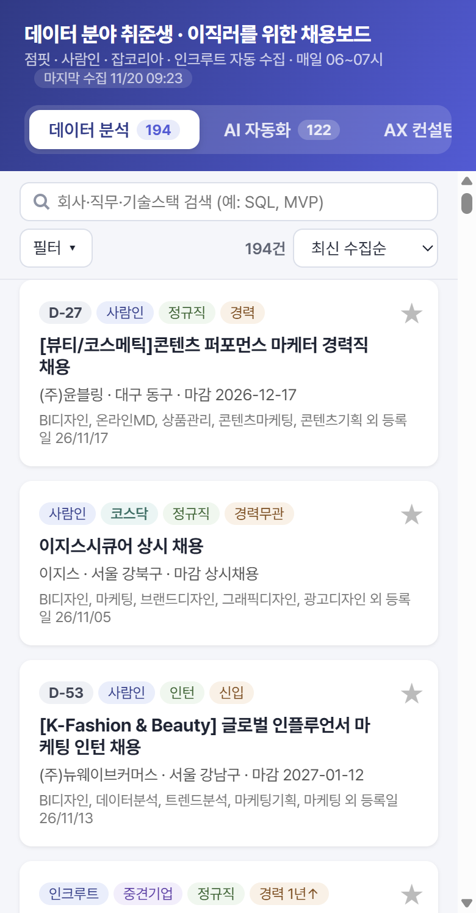
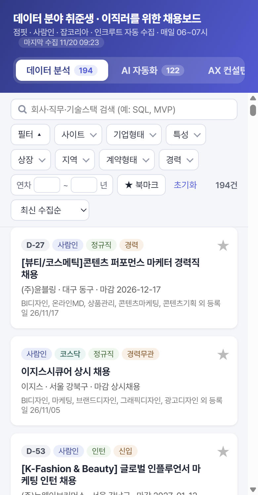

# Job Board for Data Job Seekers & Career Changers

[한국어](README.md) | **English**

A personal project that collects job postings from four Korean job sites every day and lets you **compare them by role on one screen**.
It runs on **Google Sheets (storage) + Google Apps Script (collector & web app)** only, with no server.

**Why:** Data job postings were scattered across several sites, and the same posting often appeared on each site under a slightly different title, which made daily comparison tedious.

**Tech stack:** Google Apps Script · JavaScript · Google Sheets · HTML/CSS

**Demo:** https://script.google.com/macros/s/AKfycbyqwvf315QG05Z7w8d-xo4szlatrg8TCUiqiO00QHiQG4a3uwCgilBUh16fnirgd3M1/exec (Google sign-in required; UI is in Korean)



## Features

| Feature | Details |
|---|---|
| Auto collection | Jumpit · Saramin · JobKorea · Incruit, daily at 06:00–07:00 KST |
| Role tabs | Data Analysis / AI Automation / AX Consultant (include/exclude rules remove unrelated postings) |
| Duplicate merging | The same posting from several sites becomes one card (tolerates differences in company names and titles) |
| Company info | Reads company size (large / mid-sized / small) and traits (foreign-owned, startup, listed) from each posting's detail page, shown as tags and filters |
| Filters | Site, company size, traits, listing, region, contract type, career level, years of experience (multi-select) |
| Cleanup | Unified deadlines with D-day, auto-hides expired or long-unseen postings, salary tags, NEW badge |
| Split view | Click a card to open the original posting on the right; resizable |
| Mobile | Collapsible filter bar |
| Monitoring | Logs results per site and sends an email on failure or zero results |



| Mobile (filters collapsed) | Mobile (filters expanded) |
|:---:|:---:|
|  |  |

## Architecture

```
Trigger (06–07) → collectJobs()
   ├ Collect per site (API / search-result HTML) → role check → add/update rows in job_list sheet
   ├ Read company info from new postings' detail pages
   └ Build cached page data · log run (runs) · email on problems

Open web app → doGet() → render from cached data (expired hidden, duplicates merged)
```

| Sheet tab | Purpose |
|---|---|
| `job_list` | Postings |
| `runs` | Collection log |
| `merged` | Merged postings, for review |
| `aliases` | Company name aliases (e.g. `Klemove → 클레무브`) |
| `dart` | Stock listing status (from Korea's DART corporate disclosure data, refreshed locally) |

## Setup

1. In a Google Sheet, open **Extensions → Apps Script**, paste `Code.gs`, and save
2. Run `collectJobs` (approve permissions on first run)
3. Run `installTrigger` once → daily auto collection
4. **Deploy → Web app** (execute as: me)

Roles and search keywords are set in `CATEGORIES` at the top of `Code.gs`.

## Limitations

- Most sites are parsed from HTML, so collection can stop when a site changes its layout (you get an email on zero results).
- Company info is only as good as what each posting shows. "Foreign-owned" appears mostly on JobKorea, and headhunter postings show the client company's size.
- Wanted was excluded because it blocks requests from Google servers.
- Check each site's terms of use and use only for personal, non-commercial purposes.

## How it was built

Designed the architecture with Gemini, then implemented and tested it with Claude Code.
