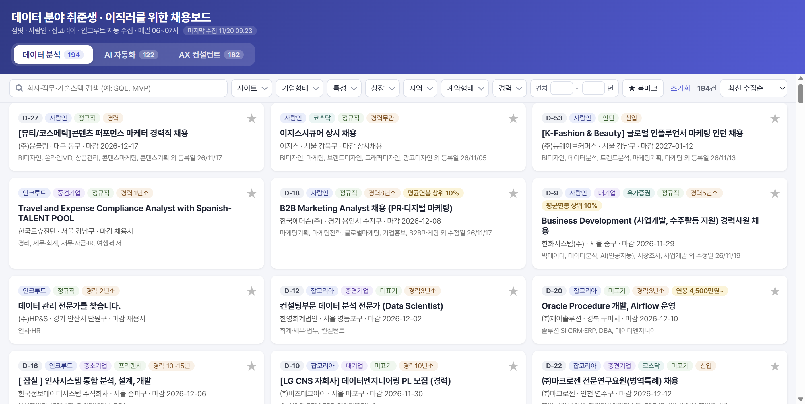
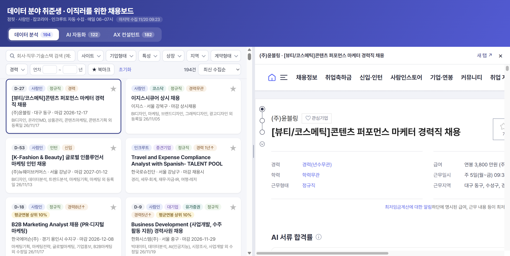

# 데이터 분야 취준생 · 이직러를 위한 채용보드

4개 채용 사이트의 공고를 매일 자동으로 모아 **직무별로 한 화면에서 비교**하는 개인 프로젝트입니다.
서버 없이 **Google Sheets(저장) + Google Apps Script(수집·웹앱)** 만으로 동작합니다.

**데모:** https://script.google.com/macros/s/AKfycbyqwvf315QG05Z7w8d-xo4szlatrg8TCUiqiO00QHiQG4a3uwCgilBUh16fnirgd3M1/exec (Google 계정 로그인 필요)



## 핵심 기능

| 기능 | 내용 |
|---|---|
| 자동 수집 | 점핏 · 사람인 · 잡코리아 · 인크루트, 매일 06~07시 |
| 직무 탭 | 데이터 분석 / AI 자동화 / AX 컨설턴트 (포함·제외 규칙으로 관련 없는 공고 제거) |
| 중복 합치기 | 여러 사이트에 올라온 같은 공고를 한 카드로 (회사명·제목 표기 차이 허용) |
| 기업 정보 | 공고 상세에서 규모(대기업·중견·중소)와 특성(외국계·스타트업·상장)을 읽어 태그·필터로 |
| 필터 | 사이트, 기업형태, 특성, 상장, 지역, 계약형태, 경력, 연차 범위 (다중 선택) |
| 공고 정리 | 마감일 통일·D-day, 마감·장기 미노출 공고 자동 숨김, 연봉 태그, NEW 배지 |
| 분할 뷰 | 카드를 누르면 오른쪽에 원문 공고, 폭 조절 가능 |
| 모바일 | 필터 줄을 접고 펼 수 있음 |
| 모니터링 | 사이트별 수집 결과 기록, 실패·0건이면 메일 알림 |



| 모바일 (필터 접힘) | 모바일 (필터 펼침) |
|:---:|:---:|
|  |  |

## 구조

```
트리거(06~07시) → collectJobs()
   ├ 사이트별 수집 (API / 검색 결과 HTML) → 직무 판정 → job_list 시트에 추가·갱신
   ├ 새 공고 상세에서 기업 정보 읽기
   └ 화면용 데이터 캐시 생성 · 수집 기록(runs) · 문제 시 메일

웹앱 접속 → doGet() → 캐시된 데이터로 화면 표시 (마감 숨김 · 중복 합치기 적용 완료)
```

| 시트 탭 | 용도 |
|---|---|
| `job_list` | 공고 |
| `runs` | 수집 기록 |
| `merged` | 합쳐진 공고 확인용 |
| `aliases` | 회사명 별칭 (예: `Klemove → 클레무브`) |
| `dart` | 상장 구분 (DART 기업개황, 로컬에서 갱신) |

## 설치

1. Google 스프레드시트 → **확장 프로그램 → Apps Script**에 `Code.gs`를 붙여넣고 저장
2. `collectJobs` 실행 (첫 실행 시 권한 승인)
3. `installTrigger` 한 번 실행 → 매일 자동 수집
4. **배포 → 웹 앱** (실행 사용자: 나)

직무·검색어는 `Code.gs` 맨 위 `CATEGORIES`에서 바꿉니다.

## 한계

- HTML을 읽는 방식이라 사이트 개편 시 수집이 멈출 수 있습니다 (0건이면 메일 알림).
- 기업 정보는 공고에 적힌 만큼만 나옵니다. 외국계는 잡코리아 공고에만 주로 표시되고, 헤드헌팅 공고는 고객사 규모가 나옵니다.
- 원티드는 Google 서버 요청을 막아 제외했습니다.
- 각 사이트 이용약관을 확인하고 개인·비상업 목적으로만 사용하세요.

## 만든 방법

Gemini와 구조를 설계하고, Claude Code로 구현·테스트했습니다.
