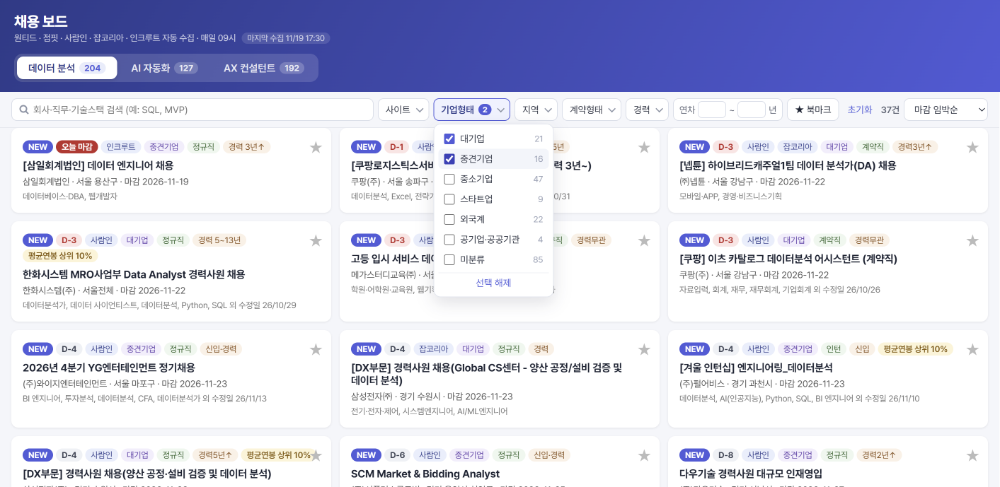

# 채용 보드 (Job Board)

여러 채용 사이트의 공고를 매일 자동으로 모아 **직무별로 한 화면에서 비교**할 수 있게 만든 개인 프로젝트입니다.
서버 없이 **Google Sheets(데이터 저장) + Google Apps Script(수집·웹앱)** 만으로 동작합니다.

**데모:** https://script.google.com/macros/s/AKfycbyqwvf315QG05Z7w8d-xo4szlatrg8TCUiqiO00QHiQG4a3uwCgilBUh16fnirgd3M1/exec
(Google 계정 로그인 필요)


## 화면 둘러보기

### 다중 선택 필터 + 마감 임박순
기업형태에서 대기업·중견기업을 함께 고르고 마감 임박순으로 정렬한 모습입니다. 카드마다 D-day, 출처 사이트, 기업형태, 계약형태, 경력, 연봉 태그가 붙습니다.



### 분할 뷰
카드를 누르면 오른쪽에 원문 공고가 열립니다. 가운데 경계를 끌어 폭을 조절할 수 있고, 같은 공고가 다른 사이트에도 있으면 상단에 링크가 함께 보입니다.


## 무엇을 하나요

- **5개 사이트 자동 수집** — 원티드 · 점핏 · 사람인 · 잡코리아 · 인크루트, 매일 새벽 6~7시
- **직무 탭** — 데이터 분석 / AI 자동화 / AX 컨설턴트 (탭마다 검색어 3개, 포함·제외 규칙으로 관련 없는 공고 정리)
- **다중 선택 필터** — 사이트, 기업형태, 지역, 계약형태, 경력 + 연차 범위(예: 1~4년)
- **공고 정리**
  - 사이트마다 다른 마감일 표기를 하나로 통일하고 D-day 표시
  - 마감됐거나 7일 넘게 검색에 안 보이는 공고는 자동으로 숨김
  - 같은 공고가 여러 사이트에 올라오면 한 카드로 합침 (회사명·제목 표기 차이 허용, 신입/경력·기수 등이 다르면 분리, 가장 정보가 많은 제목을 대표로) → 시트 `merged` 탭에서 확인
- **태그** — 기업형태(대기업·중견·중소·스타트업·외국계·공공), 연봉 정보(제시 연봉, 평균연봉, 연봉상승률), NEW
- **분할 뷰** — 카드를 누르면 오른쪽에 원문 공고가 열리고, 경계를 끌어 폭 조절
- **운영 모니터링** — 사이트별 수집 결과를 기록하고, 실패하거나 0건이면 메일로 알림

## 구조

```
┌──────────────── Google Apps Script ────────────────┐
│ collectJobs()  ← 매일 06~07시 트리거                │
│   ├ 사이트별 수집기 (API 또는 검색 결과 HTML 파싱)   │
│   ├ 직무 포함·제외 규칙 적용                         │
│   ├ 새 공고 추가 / 기존 공고 연봉·마감일·확인일 갱신 │
│   ├ 기업형태 표 갱신 (사람인 기업형태 검색 기준)     │
│   └ 수집 기록 저장 + 문제 시 메일 알림               │
│ doGet()        ← 웹앱 요청                          │
│   └ 마감 숨김 → 중복 합치기 → HTML 화면 반환         │
└───────────────────────┬────────────────────────────┘
                        │
        ┌───────────────┴───────────────┐
        │ Google Sheets                 │
        │  jobs_v3       공고           │
        │  company_types 회사명→기업형태│
        │  runs          수집 기록      │
        │  merged        합쳐진 공고    │
        │  aliases       회사명 별칭    │
        └───────────────────────────────┘
```

| 사이트 | 수집 방식 |
|---|---|
| 원티드 | 검색 API(JSON) |
| 점핏 | 검색 API(JSON) |
| 사람인 | 검색 결과 HTML |
| 잡코리아 | 검색 결과 HTML + 페이지 내 공고 데이터(마감일) |
| 인크루트 | 검색 결과 HTML(EUC-KR) |

## 직접 설치하기

1. 새 Google 스프레드시트를 만들고 **확장 프로그램 → Apps Script**를 엽니다.
2. `Code.gs`의 내용을 편집기에 붙여넣고 저장합니다.
3. 함수 목록에서 `collectJobs`를 골라 실행합니다. 처음 한 번은 권한 승인이 필요합니다.
   (스프레드시트, 외부 서비스 연결, 트리거, 이메일 보내기)
4. `installTrigger`를 한 번 실행해 매일 새벽 6~7시 자동 수집을 켭니다(Google 트리거는 지정 시각부터 1시간 안에 실행돼요).
5. **배포 → 새 배포 → 웹 앱**을 선택합니다.
   - 다음 사용자 인증 정보로 실행: **나**
   - 액세스 권한이 있는 사용자: 필요한 범위로 선택
6. 발급된 웹앱 주소로 접속합니다. 주소 뒤에 `?format=json`을 붙이면 JSON으로 받을 수 있습니다.

직무나 검색어를 바꾸려면 `Code.gs` 맨 위의 `CATEGORIES`를 수정하면 됩니다.

같은 회사인데 사이트마다 이름이 달라 합쳐지지 않으면, 시트 `aliases` 탭에 `별칭 | 기준 이름`(예: `Klemove | 클레무브`)을 한 줄 추가하세요. 다음 화면 표시부터 반영됩니다.

## 한계와 주의

- 사람인·잡코리아·인크루트는 화면 HTML을 읽는 방식이라 사이트 개편 시 수집이 멈출 수 있습니다(0건이면 메일로 알림).
- 원티드는 Google 서버에서의 요청을 간헐적으로 차단(403)합니다.
- 연봉 정보는 목록에 노출된 범위(사람인 배지, 잡코리아 급여, 공고 제목)만 반영합니다.
- 기업형태는 사람인 분류를 회사명으로 연결한 것이라, 표기가 다른 회사는 '미분류'로 남습니다.
- 각 채용 사이트의 이용약관을 확인하고, 개인 학습·비상업 목적으로만 사용하세요.

## 만든 방법

Google Gemini와 기본 구조(Sheets + Apps Script)를 설계하고, Claude Code로 수집기·필터·화면을 구현·테스트했습니다.
